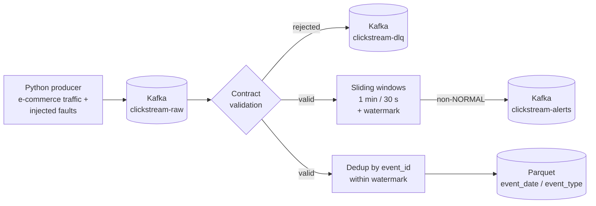

# ClickGuard Stream

Real-time **data quality gate for clickstream events**: contract validation, Dead Letter Queue routing,
windowed anomaly detection and a deduplicated, partitioned clean layer — built with
**Kafka + Spark Structured Streaming (PySpark)**.

The goal is simple: bad events must never silently reach the analytical layer. Each one is either
accepted, or rejected **with a reason and its exact Kafka coordinates**, so it can be fixed and replayed.

## Architecture



| Module | Responsibility |
|---|---|
| [`streaming/schemas.py`](streaming/schemas.py) | The event contract (v1): fields, types, required fields, allowed values |
| [`streaming/validation.py`](streaming/validation.py) | Ordered validation rules, valid/invalid split, DLQ record format |
| [`streaming/anomaly.py`](streaming/anomaly.py) | Windowed traffic metrics and classification |
| [`streaming/stream_processor.py`](streaming/stream_processor.py) | Wiring: Kafka source, three sinks, checkpoints, configuration |
| [`producer/clickstream_producer.py`](producer/clickstream_producer.py) | Traffic simulator with labelled fault injection |

Validation and anomaly logic are **pure `DataFrame -> DataFrame` functions**, so the exact code that
runs in the stream is unit-tested on small static DataFrames.

## Event contract

| Field | Type | Required | Rule |
|---|---|---|---|
| `event_id` | string | yes | used for deduplication |
| `user_id` | string | yes | |
| `session_id` | string | no | |
| `event_type` | string | yes | one of `view_offer`, `add_to_cart`, `purchase` |
| `category` | string | no | |
| `price` | double | for `purchase` | must be `>= 0` |
| `event_timestamp` | ISO-8601 string | yes | parseable, not more than 5 min in the future |

### Validation rules (first match wins)

| Error code | Example |
|---|---|
| `MALFORMED_JSON` | truncated payload, empty string, JSON array |
| `SCHEMA_TYPE_MISMATCH` | `"price": "free"` |
| `MISSING_REQUIRED_<FIELD>` | no `user_id`, or `"user_id": null` |
| `INVALID_EVENT_TYPE` | `"event_type": "hover"` |
| `INVALID_TIMESTAMP` | `"event_timestamp": "yesterday"` |
| `TIMESTAMP_IN_FUTURE` | client clock skew beyond tolerance |
| `MISSING_PRICE_FOR_PURCHASE` | purchase without a price |
| `NEGATIVE_PRICE` | `"price": -99.99` |

DLQ record:

```json
{"raw_payload": "{\"event_id\": \"...\", \"price\": \"free\", ...}",
 "validation_error": "SCHEMA_TYPE_MISMATCH",
 "kafka_topic": "clickstream-raw", "kafka_partition": 3, "kafka_offset": 18231,
 "kafka_timestamp": "2026-11-16T12:00:01.123Z",
 "contract_version": "1.0.0", "rejected_at": "2026-11-16T12:00:01.456Z"}
```

## Anomaly detection

Valid events are aggregated per **category** in **1-minute windows sliding every 30 s**:
`event_count`, `unique_users` (HyperLogLog), `events_per_user`, `purchase_count`, `avg_price`.

| Status | Rule (defaults, configurable via env) |
|---|---|
| `BOT_SUSPECTED` | `events_per_user >= 3.0` |
| `SPIKE` | `event_count > 300` |
| `DROP` | `event_count < 20` |

Non-`NORMAL` windows are printed and published to `clickstream-alerts`.

## Design decisions

- **Broken JSON detection uses `columnNameOfCorruptRecord`.** Since Spark 3.0, `from_json` returns a
  struct of NULLs (not NULL) for malformed input, so a naive `data IS NULL` check never fires and broken
  payloads get misreported as "missing field". The corrupt-record column also catches type mismatches.
- **Null-safe rules.** `NOT (event_type IN (...))` evaluates to NULL for a NULL `event_type`, which
  `when()` treats as false — required-field checks therefore run before domain checks.
- **`try_to_timestamp`** turns unparseable timestamps into a DLQ entry instead of a failed job, and
  prevents NULL event times from entering watermarked state.
- **Append output mode for alerts.** In `update` mode a window is emitted while still filling up, so
  every new window would look like a `DROP` for its first seconds. Append emits each window once, after
  the watermark closes it. Trade-off: alert latency ≈ window + watermark (~3 min).
- **Dedup with `dropDuplicatesWithinWatermark`** — client SDKs retry, so the same `event_id` can arrive
  twice. State is bounded by the 10-minute watermark.
- **Partitioning by `event_date / event_type`** with a 30 s trigger to avoid the small-files problem.
- **DLQ keeps Kafka coordinates and contract version** to make debugging and replay possible.

## Running locally

Requirements: Docker, Python 3.10+, **Java 17+** (Spark 4).

```bash
make install && source .venv/bin/activate
make up            # Kafka (KRaft) + topic creation
make stream        # terminal 1: Spark job
make produce       # terminal 2: traffic generator (bot burst every 2 min)
make consume-dlq   # terminal 3: watch rejected events
make consume-alerts
```

Clean data lands in `output/clean_clickstream/event_date=.../event_type=.../`.

## Tests

```bash
make test
```

- `test_validation.py` — every validation rule, rule precedence, mixed batches, Kafka metadata in DLQ
- `test_anomaly.py` — `NORMAL / SPIKE / DROP / BOT_SUSPECTED` classification and aggregates
- `test_producer_contract.py` — every fault injected by the producer is classified as expected

CI runs the suite on every push (GitHub Actions, Java 17 + Python 3.12).

## Limitations and next steps

- **Schema Registry + Avro/Protobuf** instead of JSON, with compatibility checks for contract evolution.
- **Unknown fields are silently dropped**; a strict mode could flag them for contract owners.
- **Static thresholds** → per-category baselines (e.g. z-score against a rolling mean of the same hour
  last week) using arbitrary stateful processing (`transformWithState`).
- **A `DROP` to zero is invisible** — windows without events are never emitted; it needs a heartbeat or
  an expected-categories reference set.
- **Events later than the watermark are dropped** from aggregations without a trace; they could be
  counted and routed to a separate topic.
- **Three queries read the raw topic independently**; one `foreachBatch` fan-out would read it once.
- **Table format**: Iceberg / Delta Lake instead of plain Parquet (ACID, compaction, time travel).
- **Observability**: DLQ rate and per-rule counters exported as metrics (`StreamingQueryListener`).
